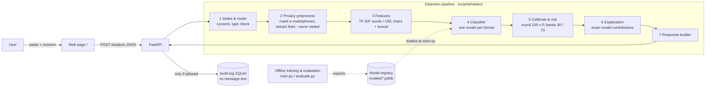
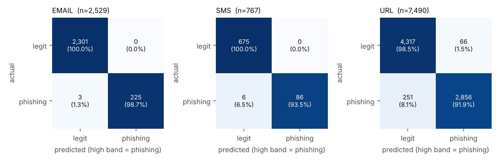
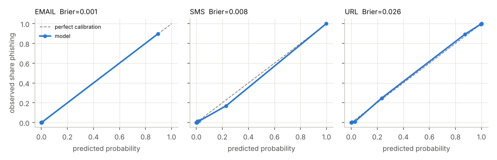
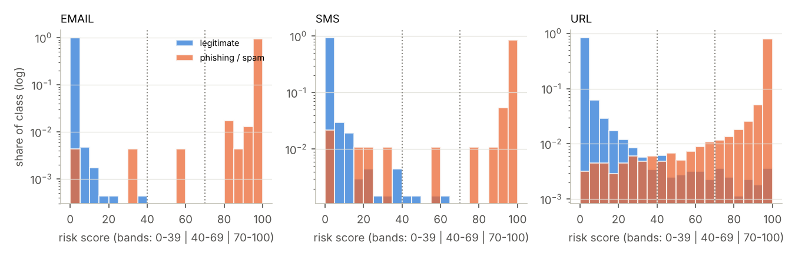

# AI Phishing & Scam Detector

**CSIT305 Research Project, University of Wollongong in Dubai**
Djamel Salmi · Shehzad Siddiqui · Imad Rahman · Abdul Mohimin · Abdallah Al Faqih
Instructor: Ms. Pradnya Bhagwat

A locally hosted research prototype that checks a pasted **e-mail, SMS or link**, gives a
**0–100 risk score** in three bands (low / uncertain / high), and explains the warning using
cues that **actually appear in the input**. It exists to collect evidence for our research
question:

> How effectively can machine-learning, NLP and LLM-assisted approaches identify phishing and
> scam attempts in e-mail, SMS and URLs, and how accurately and understandably can they explain
> their warnings?

> **Status: v0.2.0 research prototype.** It is decision support, not a guarantee of safety.
> The optional LLM comparator and the user-understanding study were **not** carried out (see
> [Limitations](#limitations)).

---

## 1. What it does

```
POST /analyze  {"type": "sms", "text": "Your parcel is held. Pay at delivery-update-example.test", "consent": true}

→ label: phishing   risk: 99   band: high
  explanation: This looks risky because: call to action (click / call / reply); parcel or delivery;
               the website ends in an uncommon domain extension; the website name contains several hyphens.
  advice: Do not click links, reply or share details. Contact the organisation through its official
          website or phone number that you look up yourself.
```

A full recorded session with the live server is in
[`evidence/api_demo_transcript.txt`](evidence/api_demo_transcript.txt).

## 2. Architecture



| Step | Module | What happens |
|---|---|---|
| 1 Intake | `api.py`, `pipeline.py` | Refuses requests without consent (HTTP 403); rejects empty, unsupported or non-URL input (HTTP 422). |
| 2 Privacy preprocessing | `preprocess.py` | Masks e-mail addresses and phone numbers; strips HTML; extracts links (including `href` links) **without opening them**; truncates at 20,000 characters. |
| 3 Features | `train.py`, `url_features.py`, `url_model.py` | Text: word and two-word TF-IDF. URLs: character fragments (3–5 chars) + 21 readable lexical features (length, hyphens, IP host, `@`, shortener, punycode, brand misuse, …). |
| 4 Classifiers | `train.py` | One logistic regression per format. Comparators: linear SVM (text), random forest (URL, the v0.1.0 design). |
| 5 Risk mapping | `pipeline.py` | Probabilities calibrated on validation data (sigmoid). Risk = round(100 × P). For a message with links, the higher of text and link risk is used. 0–39 low, 40–69 uncertain ("suspicious – check before acting"), 70–100 high. |
| 6 Explanation | `explain.py` | Each cue is an exact model contribution (feature value × coefficient) from the input itself. No LLM, so no invented reasons. |
| 7 Response / audit | `pipeline.py`, `audit.py` | JSON with label, risk, band, cues, plain-language explanation, advice, notes, model version, timing. Audit row (no text, no URLs) only when `allow_logging` is true. |

## 3. Repository layout

```
src/phishdetect/   preprocess.py  url_features.py  url_model.py  data.py  train.py
                   explain.py  pipeline.py  audit.py  api.py  evaluate.py  static/index.html
tests/             23 unit + integration tests (pytest)
evidence/          evidence_log.csv, edge_cases.csv (+ results), challenge_set.csv,
                   pytest_output.txt, api_demo_transcript.txt
results/           metrics.json, criteria_table.csv, challenge_results.csv, figures/,
                   history/v0.1.0/ (first evaluation, kept for comparison)
models/            registry.json (model *.joblib files are rebuilt by training)
scripts/           get_data.sh, draw_architecture.py, report builders
docs/              GITHUB_SETUP.md, STUDY_GUIDE.md
report/            corrected group report (.docx)
```

## 4. Datasets

| Format | Source | Labels used | After cleaning (train / val / test) |
|---|---|---|---|
| E-mail | Nazario phishing corpus [12] + Enron e-mails [13] (CSV mirror) | phishing = Nazario; legitimate = Enron **ham only** (Enron spam dropped) | 16,858 (11,800 / 2,529 / 2,529); 9% phishing |
| SMS | UCI SMS Spam Collection [3] | spam vs ham. **Spam ≠ smishing** – see limitations | 5,108 (3,575 / 766 / 767); 12% spam |
| URL | Sahingoz et al. URL lists [2] | phishing vs legitimate | 50,226 (33,380 / 9,356 / 7,490); 41% phishing |

Cleaning: empty and conflicting items removed; exact and near-duplicates removed (23,349 URLs,
496 e-mails, 464 SMS); text normalised identically for both classes. Splits are 70/15/15 with
seed 42: stratified for text; **grouped by website for URLs**, so no website appears in two sets.

The proposal named PhiUSIIL [14] for URLs. We used the Sahingoz et al. data instead because it
is the dataset of the URL study we build on [2] and was downloadable for this build; PhiUSIIL
remains a good next test set.

## 5. How to reproduce

**Easiest:** double-click `run_windows.bat` (Windows) or run `bash run_mac_linux.sh` (Mac/Linux).
It installs everything, starts the server and opens http://127.0.0.1:8000. Manual steps:

Python 3.10+ (results below were produced with Python 3.13, scikit-learn 1.9.1, pandas 3.0.5,
NumPy 2.5.3, FastAPI 0.162.0).

```bash
git clone <this repo> && cd phishing-detector
python -m venv .venv && source .venv/bin/activate      # Windows: .venv\Scripts\activate
pip install -r requirements.txt

bash scripts/get_data.sh                 # downloads the three datasets into data/raw/
cd src
python -m phishdetect.train              # ~2 min; writes models/*.joblib and models/registry.json
python -m phishdetect.evaluate           # ~1 min; writes results/ and evidence/edge_case_results.csv
cd ..
python -m pytest -v                      # 23 tests
uvicorn phishdetect.api:app --app-dir src --port 8000
# open http://127.0.0.1:8000 for the web page, or http://127.0.0.1:8000/docs for the API
```

Everything is seeded (`SEED = 42`), so re-running gives the same numbers.

**Quick demo without downloading data:** if `models/*.joblib` are present (they are in the shared zip),
skip `get_data.sh` and training and go straight to `pip install -r requirements.txt` and the `uvicorn` line.

## 6. Results (held-out test sets, v0.2.0)

Each model was scored once on its test split, which was never used for training, choosing
settings or calibration. Formats are reported separately and never pooled.
“High band” means risk ≥ 70.

| Criterion (target) | E-mail | SMS (spam) | URL |
|---|---|---|---|
| Recall, high band (≥ 0.90) | **0.987** ✓ | **0.935** ✓ | **0.919** ✓ |
| Recall, high + uncertain (≥ 0.97) | 0.991 ✓ | 0.946 ✗ | 0.963 ✗ |
| Legitimate in high band (≤ 2%) | 0.0% ✓ | 0.0% ✓ | 1.5% ✓ |
| Precision | 1.000 | 1.000 | 0.977 |
| F1 (≥ 0.85), 95% bootstrap CI | 0.993 (0.985–1.000) ✓ | 0.966 (0.937–0.990) ✓ | 0.947 (0.941–0.953) ✓ |
| Brier score (≤ 0.10) | 0.001 ✓ | 0.008 ✓ | 0.026 ✓ |
| Baseline − comparator F1, 95% CI | +0.002 (0.000 to +0.007) vs SVM | 0.000 (identical) vs SVM | **+0.137** (+0.126 to +0.148) vs random forest |
| Median time: classify / full result (≤ 0.5 s / ≤ 3 s) | 1.6 ms / 2.4 ms ✓ | 1.0 ms / 1.6 ms ✓ | 1.6 ms / 2.6 ms ✓ |
| *Ext.* Legitimate in uncertain band (≤ 10%) | 0.0% ✓ | 0.6% ✓ | 2.0% ✓ |
| *Ext.* Precision at 90% recall, 5% phishing (≥ 0.75) | 1.00 ✓ | – | 0.82 (0.74–0.89) ✓ |
| *Ext.* Recall drop on newer attacks (≤ 5 points) | 4.6 points (0.95 → 0.90, trained ≤ 2019, tested 2020–22) ✓ | – | – |
| *Ext.* Explanation cues supported by the input (≥ 85%) | 100% of 264 cues (automated check) ✓ | | |
| User understanding (≥ 70%), rater kappa, click-through | **not measured** – needs ethics approval | | |

Full table: [`results/criteria_table.csv`](results/criteria_table.csv); all numbers:
[`results/metrics.json`](results/metrics.json).





### Challenge set: 40 modern messages written for this project
Fluent, AI-written phishing and everyday legitimate messages (UAE and university context) that
appear in no dataset ([`evidence/challenge_set.csv`](evidence/challenge_set.csv)).

| | Phishing in high band | Phishing high or uncertain | Legitimate flagged |
|---|---|---|---|
| E-mail (8 + 8) | 7/8 | 7/8 | 1/8 |
| SMS (8 + 8) | 5/8 | 7/8 | 0/8 |
| URL (4 + 4) | 4/4 | 4/4 | 1/4 |

Missed: a gift-card request from a "manager" and a "Hi mum, new number" SMS – scams with **no
link and no typical scam words**. False alarms: the real `paypal.com/ae/home` (100) and a genuine
bank-statement e-mail (87). The challenge set was **not** used to change the models.

### Edge cases and tests
18/18 edge cases pass ([`evidence/edge_case_results.csv`](evidence/edge_case_results.csv)):
empty input, broken links, IP-address links, `@` links, punycode, shorteners, Arabic text,
emoji-only, very long e-mails, >10 links, HTML links, no consent, wrong type.
23/23 automated tests pass ([`evidence/pytest_output.txt`](evidence/pytest_output.txt)).

## 7. Development iterations

Full record: [`evidence/evidence_log.csv`](evidence/evidence_log.csv) (17 entries).

| Version | Change | Why | Effect |
|---|---|---|---|
| 0.1.0 | Baseline as proposed: TF-IDF + logistic regression (text), random forest on lexical URL features | Proposal Table II | URL: F1 0.854, false alarms 5.2%, precision 0.30 at 5% phishing – 3 core URL criteria failed ([history](results/history/v0.1.0/)) |
| 0.1.0 | Scheme / `www.` removed from URLs; text normalised identically for both classes | Found dataset collection artefacts that would leak labels | Model judges the link, not the dataset |
| 0.2.0 | URL split grouped by website | 66% of v0.1.0 test URLs shared a website with training data | Honest test on unseen websites |
| 0.2.0 | URL model → logistic regression on character fragments + lexical features; RF kept as comparator | RF dropped to F1 0.803 on unseen websites | F1 0.947, false alarms 1.5%, precision 0.82 at 5% phishing |
| 0.2.0 | Explanations hide stop-words and fragments < 4 characters | Cues like "your" or "amp" mean nothing to users | Still 100% evidence-supported |
| 0.2.0 | Rejects non-URL text sent as a URL; note for non-English input | Edge cases E04 and E10 | 18/18 edge cases pass |

## 8. Limitations

- **E-mail scores are probably optimistic.** Legitimate e-mails come from one company in
  2000–2002 and phishing from 2015–2022, so part of the signal may be "not Enron". The time-split
  test and the challenge set (7/8 caught, 1/8 false alarm) are the more realistic indicators.
- **SMS results measure spam, not smishing.** No licensed, phishing-labelled SMS corpus was
  available for this build.
- **Brand names cause false alarms** on real brand websites (e.g. `paypal.com`), because they
  appear so often in phishing links.
- **Scams without links or scam vocabulary are missed** (gift-card / "new number" fraud).
- **English only.** Arabic or other non-Latin text is flagged with a note; only links are
  assessed reliably.
- **Explanation quality is checked automatically only** (every cue exists in the input; same input
  gives the same cues). Clarity and user comprehension were not tested with people.
- **No LLM comparator was run** – it needs privacy approval to send text to an external API.
- Datasets age quickly; new attack styles and URL patterns cause drift.
- Name masking is not implemented (only e-mail addresses and phone numbers are masked).

## 9. Responsible use

Links are parsed, never visited. Nothing is sent to external services. The audit log stores
no message text or URLs and is written only when the user ticks the box. A false negative can
expose someone to fraud and a false positive can block real messages, so results are shown as
risk bands with advice, not verdicts.

## 10. AI-use declaration

Generative AI (Claude, Anthropic) was used to help write parts of the code, tests, challenge
set and this README. See the AI-use declaration in the project report for what was used where
and how each output was verified.

## References

[2] O. K. Sahingoz et al., "Machine learning based phishing detection from URLs," *Expert Syst. Appl.*, vol. 117, 2019.
[3] T. A. Almeida et al., "Contributions to the study of SMS spam filtering," *Proc. DocEng*, 2011.
[12] J. Nazario, "The online phishing corpus," monkey.org/~jose/phishing.
[13] B. Klimt and Y. Yang, "The Enron Corpus," *ECML*, 2004.
[14] A. Prasad and S. Chandra, "PhiUSIIL," *Computers & Security*, 2024.
